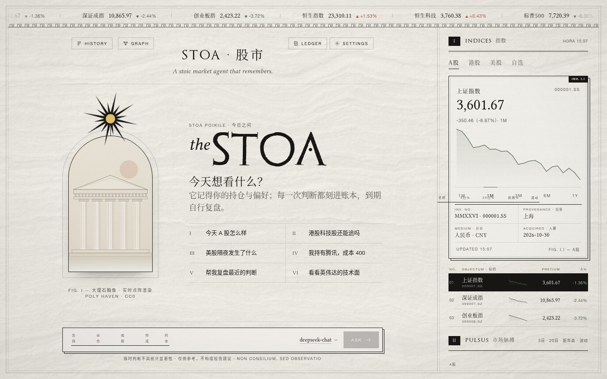

# Stoa

**A stock-market agent with memory, for China A-shares, Hong Kong and US stocks.**

[Download for Windows](https://github.com/jiuyang5354/Stoa/releases/latest) · [Quick start](#quick-start) · [Features](#features) · [Status](#status)

[简体中文](README.md) | English

## Status

- Public beta, changing quickly. See [Releases](https://github.com/jiuyang5354/Stoa/releases) for what each version changed.
- Bullish / bearish timing calls were **not statistically significant** in our backtests and track simple momentum. Use Stoa for research, risk checks and briefings, not as a trading signal.
- The app UI is in Chinese or English (Settings → General → Language).
- **For information only. Not investment advice.**

## Quick start

| Option | For | How |
|---|---|---|
| Windows portable | Just use it | Download [Stoa-Windows.zip](https://github.com/jiuyang5354/Stoa/releases/latest), unzip, double-click `Stoa.exe` (bundled Python, no install) |
| Docker | Always on, scheduled briefings | `cp .env.example .env`, set your model key, `docker compose up -d`, open http://localhost:8080 |
| Python | Development, CLI | `pip install -r requirements.txt`, `python -m stock_agent serve` |

If no model is configured, the first message opens Settings → Model. Quotes and briefings work without a model.

## Features

- **Markets**: SSE, SZSE, ChiNext, Hang Seng, HS Tech, S&P 500, Nasdaq, Dow, plus any watchlist symbol (Yahoo format: `600519.SS`, `0700.HK`, `NVDA`).
- **Research tools**: news, company announcements (Eastmoney, SEC EDGAR), financials and valuation, analyst consensus, A-share money flow and Dragon-Tiger list, US options (IV, put/call, max pain), annual-report / 10-K reading with page-level citations.
- **Agora debate**: four analysts gather data in parallel, bull and bear researchers argue, a risk officer checks concentration and stops (with veto), and a portfolio manager gives a view, confidence, key evidence and what would prove it wrong. Every call is logged.
- **Cited numbers**: prices, returns and financial figures carry source footnotes; unsourced numbers are rewritten or flagged.
- **Memory**: a profile of you (holdings, cost basis, preferences), the agent's own notes, learned skills, a ledger of every call reviewed when due, hybrid keyword + vector recall, and rolling summaries for long chats. Shown as a memory graph.
- **Briefings and alerts**: morning and evening reports on trading days, price / move / announcement alerts, earnings-day reports, pushed to WeChat (ServerChan), WeCom, Feishu or Telegram.
- **Bring your own model**: 20+ presets (DeepSeek, Qwen, Kimi, GLM, Doubao, Claude, Gemini, Ollama, …) and custom sources for any OpenAI-compatible, Anthropic or Gemini endpoint, with fallback chains.
- **Interfaces**: desktop window, web UI, slash commands, OpenAI-compatible `/v1` API, MCP server, MCP client, Telegram bot.
- **Backtest and evals**: point-in-time backtests with baselines (buy-and-hold, random, momentum), rank-IC evaluation, and a fixed eval set for quote accuracy, refusal to fabricate, risk and memory — plus, since v0.35, an adversarial set (forged targets and financials, stale or impossible quotes, prompt injection in web pages / search results / filings, "guaranteed?" and "go all in" inducements, fabricated numbers), scored on whether unsourced numbers are caught, risks are named, invalidation conditions are given and guaranteed returns are refused (`python -m stock_agent eval --only 对抗`; runs in mock mode and in CI).

Full documentation is in the [Chinese README](README.md).

Code execution is off by default. When explicitly enabled, it requires Docker and a locally built `stoa-sandbox:local` image (`docker build -t stoa-sandbox:local packaging/sandbox`). Each run has no network, a read-only root filesystem and only the workspace mounted. When Docker or the image is unavailable, Stoa falls back to a restricted local mode (separate subprocess, 60 s timeout, secret-looking env vars removed, working directory pinned to the workspace, 1 GB memory cap on Linux/macOS, truncated output) and labels the result "本机受限模式". It is not a real sandbox; set `CODE_SANDBOX=docker` to require Docker and refuse otherwise. The standard Compose service has no Docker access, so its code tool runs in that local mode inside the app container. Do not mount the host Docker socket into the app container to enable it.

Quote checks bind recognized stock symbols or known names to quote fields and dates. They do not fully validate arbitrary financial prose, pronouns or cross-paragraph references. A source footnote alone is not proof that a claim is correct.

## Reliability and data checks

- Stopping a conversation terminates its active model request, including retry waits; fallback models share a total deadline. Other tools stop at their next checkpoint.
- Decorative rendering and quote/news/inquiry polling pause while the page is hidden and resume when visible. Background answers continue.
- Quote cards expose source, currency or index points, source date, retrieval time, timezone and cache status. Trading hours are weekday/clock estimates without a verified holiday calendar. Financial checks cover recognized companies, fields, currencies and report periods and remain heuristic.
- New memories distinguish planned, historical, pending and confirmed holdings. Agent-added holdings require confirmation; changes can be audited and undone without overwriting newer edits. Concurrent history/chat requests use thread-local SQLite connections, and memory file reads share the write lock.
- Updates verify the release asset SHA-256, retain the previous installation and roll back if the backend version fails its startup check.

## v0.35 · Mensura

- **Per-role debate models**: Agora analysts (four analysts + bull/bear researchers) and judges (risk officer, portfolio manager, editor) can use different models via Settings → Tools, `debate.analyst_model` / `debate.judge_model` in config.yaml, or `DEBATE_ANALYST_MODEL` / `DEBATE_JUDGE_MODEL`. Write a model name to reuse the default provider's endpoint and key, or `provider:model`. Empty means every role uses the default model, exactly as before. Each role still makes one request; a failing role model uses the existing fallback chain and does not retry on the default model.
- **External-content guard**: web pages, search results, news, announcements, filings, MCP results and attachments that contain instruction-like text ("ignore previous instructions", "call tool X") are labelled as suspected prompt injection, and in that turn write actions the user did not ask for (memory, watchlist, alerts, scheduled tasks, skills, files) are blocked in code.
- **Data sanity warnings**: quotes older than 10 days, A-share daily moves beyond 30 %, analyst targets more than 3× away from the price, and out-of-range ratios are flagged as suspect. Numbers are never changed.
- **Historical base rates for morning calls**: from ~250 trading days of daily bars, ATR-normalized, Stoa records how often a move of the same size happened within the call's horizon — for the call being right (expiry close, same rule as the ledger) and for touching the invalidation price (intraday high/low). Evening reports and ledger stats compare hit rate with the average base rate, with the gap and sample size; fewer than 20 samples are marked as insufficient. A base rate is a no-skill reference, not a forecast probability.

### 0.35.1

- Short names are now bound to their stock when checking numbers: "Moutai jumped 8.4% today" is checked against that stock's actual daily change; a same-day move with no stock named is checked against each quote in the turn, never against a ratio of two unrelated numbers.
- Quick answers (not deep analysis) that give a bullish / bearish / buy / target-price view without an invalidation condition get one appended from the turn's quote data (e.g. "no longer holds if it closes below the 20-day average 498.21"), or an event condition when there is no quote. Rule-based, no extra model request.
- Questions about going all in, borrowing or leverage, or guaranteed gains get a risk line (concentration, margin calls / forced liquidation, drawdown) when the answer does not already name it. Normal questions are untouched; trading and risk rules are unchanged.

## License

MIT. Third-party assets are listed in the Chinese README under 素材.
