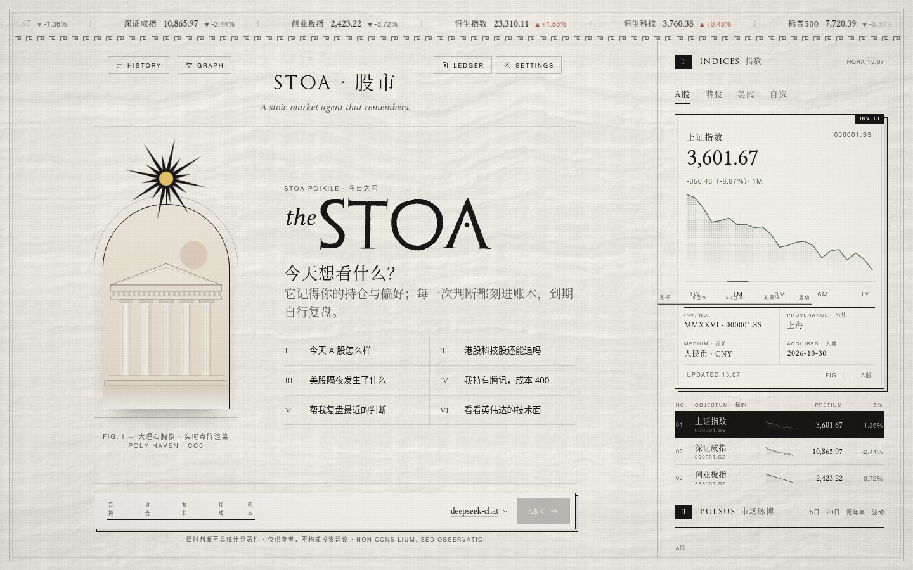

# Stoa

**A stock-market agent with memory, for China A-shares, Hong Kong and US stocks.**

[Download for Windows](https://github.com/jiuyang5354/Stoa/releases/latest) · [Quick start](#quick-start) · [Features](#features) · [Status](#status)

[简体中文](README.md) | English

## Status

- Public beta, changing quickly. See [Releases](https://github.com/jiuyang5354/Stoa/releases) for what each version changed.
- Bullish / bearish timing calls were **not statistically significant** in our backtests and track simple momentum. Use Stoa for research, risk checks and briefings, not as a trading signal.
- The app UI is in Chinese or English (Settings → General → Language).
- **For information only. Not investment advice.**

## Quick start

| Option | For | How |
|---|---|---|
| Windows portable | Just use it | Download [Stoa-Windows.zip](https://github.com/jiuyang5354/Stoa/releases/latest), unzip, double-click `Stoa.exe` (bundled Python, no install) |
| Docker | Always on, scheduled briefings | `cp .env.example .env`, set your model key, `docker compose up -d`, open http://localhost:8080 |
| Python | Development, CLI | `pip install -r requirements.txt`, `python -m stock_agent serve` |

If no model is configured, the first message opens Settings → Model. Quotes and briefings work without a model.

## Features

- **Markets**: SSE, SZSE, ChiNext, Hang Seng, HS Tech, S&P 500, Nasdaq, Dow, plus any watchlist symbol (Yahoo format: `600519.SS`, `0700.HK`, `NVDA`).
- **Research tools**: news, company announcements (Eastmoney, SEC EDGAR), financials and valuation, analyst consensus, A-share money flow and Dragon-Tiger list, US options (IV, put/call, max pain), annual-report / 10-K reading with page-level citations.
- **Agora debate**: four analysts gather data in parallel, bull and bear researchers argue, a risk officer checks concentration and stops (with veto), and a portfolio manager gives a view, confidence, key evidence and what would prove it wrong. Every call is logged.
- **Cited numbers**: prices, returns and financial figures carry source footnotes; unsourced numbers are rewritten or flagged.
- **Memory**: a profile of you (holdings, cost basis, preferences), the agent's own notes, learned skills, a ledger of every call reviewed when due, hybrid keyword + vector recall, and rolling summaries for long chats. Shown as a memory graph.
- **Briefings and alerts**: morning and evening reports on trading days, price / move / announcement alerts, earnings-day reports, pushed to WeChat (ServerChan), WeCom, Feishu or Telegram.
- **Bring your own model**: 20+ presets (DeepSeek, Qwen, Kimi, GLM, Doubao, Claude, Gemini, Ollama, …) and custom sources for any OpenAI-compatible, Anthropic or Gemini endpoint, with fallback chains.
- **Interfaces**: desktop window, web UI, slash commands, OpenAI-compatible `/v1` API, MCP server, MCP client, Telegram bot.
- **Backtest and evals**: point-in-time backtests with baselines (buy-and-hold, random, momentum), rank-IC evaluation, and a fixed eval set for quote accuracy, refusal to fabricate, risk and memory — plus, since v0.35, an adversarial set (forged targets and financials, stale or impossible quotes, prompt injection in web pages / search results / filings, "guaranteed?" and "go all in" inducements, fabricated numbers), scored on whether unsourced numbers are caught, risks are named, invalidation conditions are given and guaranteed returns are refused (`python -m stock_agent eval --only 对抗`; runs in mock mode and in CI).

Full documentation is in the [Chinese README](README.md).

Code execution is off by default. When explicitly enabled, it requires Docker and a locally built `stoa-sandbox:local` image (`docker build -t stoa-sandbox:local packaging/sandbox`). Each run has no network, a read-only root filesystem and only the workspace mounted. When Docker or the image is unavailable, Stoa falls back to a restricted local mode (separate subprocess, 60 s timeout, secret-looking env vars removed, working directory pinned to the workspace, 1 GB memory cap on Linux/macOS, truncated output) and labels the result "本机受限模式". It is not a real sandbox; set `CODE_SANDBOX=docker` to require Docker and refuse otherwise. The standard Compose service has no Docker access, so its code tool runs in that local mode inside the app container. Do not mount the host Docker socket into the app container to enable it.

Quote checks bind recognized stock symbols or known names to quote fields and dates. They do not fully validate arbitrary financial prose, pronouns or cross-paragraph references. A source footnote alone is not proof that a claim is correct.

## Reliability and data checks

- Stopping a conversation terminates its active model request, including retry waits; fallback models share a total deadline. Other tools stop at their next checkpoint.
- Decorative rendering and quote/news/inquiry polling pause while the page is hidden and resume when visible. Background answers continue.
- Quote cards expose source, currency or index points, source date, retrieval time, timezone and cache status. Trading hours are weekday/clock estimates without a verified holiday calendar. Financial checks cover recognized companies, fields, currencies and report periods and remain heuristic.
- New memories distinguish planned, historical, pending and confirmed holdings. Agent-added holdings require confirmation; changes can be audited and undone without overwriting newer edits. Concurrent history/chat requests use thread-local SQLite connections, and memory file reads share the write lock.
- Updates verify the release asset SHA-256, retain the previous installation and roll back if the backend version fails its startup check.

## v0.40 · Modus — position limits, per-turn quality metrics

- **Position limit** (`position_limit`, deterministic Python, no model call; idea from virattt/ai-hedge-fund risk/limits: the model holds the view, arithmetic does the clamping). Three caps, the smallest wins: single-name weight of capital by risk level (`risk.max_weight`: conservative 10% / moderate 20% / aggressive 30%), 1% of 20-day average daily turnover (`risk.adv_pct`), and a risk budget (loss at the stop ≤ `risk.risk_per_trade` of capital: 0.5% / 1% / 2%). The stop reference is price − `risk.atr_mult` × ATR14 unless you give a stop %. Returns each cap in money and shares, which cap binds, the final cap (A-shares rounded down to 100-share lots; Hong Kong board lots are not available and this is stated; US 1 share), the maximum loss at the stop and the cash left over (clipped size is not reallocated). Cited as a recomputable source. Pre-selected only when the question mentions capital/position size; the prompt requires capital or holdings before calling it and forbids presenting it as a buy recommendation.
- **Per-turn quality metrics**: every answer appends one line to `data/quality/YYYY-MM.jsonl` (time, session, model, seconds, prompt/completion/cached tokens, model and tool calls, key numbers verified/unverified, answer-check additions, gates/quality gate/fallback, timeout; a thumbs-down adds an event line). Only lengths are stored, never the question or answer text; write failures never affect the answer. Settings → Usage (`/usage`) shows the last 7 days by model.
- **Fix**: decision words (tomorrow, next week, judge, can I buy…) add the investment disclaimer only together with investment context (stocks, tickers, names, buy/sell, position, price moves, funds, indices) or a market tool used this turn; weather, code review and date questions no longer get it (regression from #10).

## v0.39.1

- **Online review writes where it will be read again** (found by a 10-question live test on gpt-6.1-sol): the review snapshot records which skills the turn actually read (auto-attached or `skill_view`); non-correction notes only land on those skills (4 of 5 live notes had gone to built-in skills that are never read for that kind of question). New review skills carry `auto:` triggers taken from the question (2–12 chars, must appear in the question, generic words such as closing price / P/E / trading day are dropped) and are auto-attached to similar questions on the model they were learned on; triggers survive later patches.
- **No duplicate or misplaced memory**: research turns no longer write method notes into MEMORY.md (they go into per-model skills); when the assistant already saved the correction with the `memory` tool, the review does not add a near-duplicate.
- **Pasted injection is not learned from**: text pasted into the user's own message that matches the injection patterns (`taint.scan`) now skips the review, as tool results and attachments already did.
- **Windows updater** (merged #7): a busy install directory (WinError 5) now explains what to close; pre-flight failures still write a result; stale stoa-update-* temp dirs are swept.
- Skills created from a user correction apply to all models; the Learned page lists built-in skills that received review notes; `evolve <subcommand> --help` prints usage instead of running the curator.

## v0.39 · Eruditio — self-evolution

Modeled on Hermes Agent v0.22 (background review + curator), RRSI (arXiv 2609.24972: train/held-out split against overfitting) and Google Harness² (arXiv 2610.14224: matched-condition contrasts). Only skills, prompt additions and notes in the data folder change; code, risk red lines, citation checks, injection defenses and guard constraints are never changed automatically.

- **Background review**: after a quick answer that used ≥ 3 tools (or when you correct the previous answer), an auxiliary model (`evolve.review_model`, default: the Agora analyst model) reviews the turn without blocking it. Working research recipes become skills; your corrections go into the matching skill and MEMORY.md; lexicon/alias misses are routed to the v0.36 thumbs-down pipeline. Turns that read suspected injected content, scheduled runs and evals are never reviewed. `EVOLVE_REVIEW=off` disables it.
- **Per-model records**: evolved skills, notes added to existing skills, prompt and tool-description additions record the model they were learned/validated on and are not applied to a different (especially smaller) model until `python -m stock_agent evolve gate --model <name>` passes on it. Your own corrections apply to every model.
- **Curator**: agent/review/evolve skills go stale after 14 idle days (index lists names only) and are archived after 30 (recoverable); near-duplicates are merged; at most 20 own skills are listed in full. Pinned, user and built-in skills are untouched.
- **Offline evolution** `python -m stock_agent evolve`: failure traces (thumbs-down, failing replay cases, latest eval, `--failures` file) → candidate edits (skills, prompt/tool-description additions; code only as patches) → critic (too large, task-specific ids/text/numbers, red-line weakening, already tried) → gate: tasks split by id hash into train/held-out (35%, held-out failures hidden from the proposer); a candidate passes only if train improves and held-out does not regress; edits per candidate anneal per round.
- **Write gate**: `evolve.write_approval` (default skills/memory auto, prompts/rules approve). Changes touching risk warnings, sources/verification, injection defenses or confirmation always require approval; weakening edits are blocked; code changes are written as patches for review.
- **Versions & rollback**: every write is recorded (before/after, origin, model, gate scores); `evolve rollback [<id>|--last]` or one click in Settings → Learned (`/learned`).
- Usage now tracks cached input tokens (`cached_tokens`).

## v0.38.1

- **A slow model request no longer ends the turn**: a single request that exceeds its 120-second window (including its own 429/5xx retries) is retried with backoff or switched to the fallback model while the turn still has time (`LLM_TIMEOUT_RETRIES`, default 3). Only the real turn limit, or exhausted retries, ends the turn — with the tool results and interim notes gathered so far and the real cause and elapsed time, never an empty "reached the 900-second limit".
- **Citations**: totals computed with calc and other data for the same ticker (Southbound flows) count as sources in sentences that name the ticker; sector flows cite the provider that actually served them (Eastmoney or Sina); web pages show "fetched on" instead of "as of" and are not treated as trading days; your memory is cited only for your own holdings, costs and calls; 52-week highs/lows are labelled as closing-price based; "backtested" claims are removed unless a backtest ran in the turn.

## v0.38 · Aestimatio

- **Comparables & modeling** (`fin_model`): `comps` (P/E, P/B, EV/EBITDA, EV/Sales, EV/EBIT, D/E, D/Cap, EBITDA margin + peer mean/median/range/rank, optional leases in EV, implied value from peer medians), `dcf` (yearly UFCF, exit multiple and/or perpetual growth, mid-year option, EV → equity → per share), `lbo` (sources & uses with excess cash above minimum, average-balance interest solved iteratively, full cash sweep, exit EV/equity, MOIC, IRR) and `coverage` (EBITDAR, FCCR, multi-company diff). Every result carries the yearly table and formulas.
- **Hong Kong data & turnover**: quotes include volume and turnover; `get_southbound` (Southbound daily net buy, plus a stock's Stock Connect net buy on days it is a top-10 traded name); `hk_interests` (HKEX disclosure-of-interests notices with links); `price_history` falls back to Tencent daily bars for ^HSTECH/^HSI/^HSCE.
- **Delisted US tickers**: when Yahoo has no history, the CIK is recovered from EDGAR display names and the close is read from merger proxies / tender documents ("On July 28, 2025 … closing price … $171.65").
- **Long documents**: `fetch_url` reads PDFs and paginates with `start`; `doc_digest` reads the whole document in ~6,000-character parts and extracts points from every part, reporting coverage.
- **Pre-answer gates** (one bounce each): personnel/role facts must be checked online in the same turn; Python code is compiled (and run in the sandbox when `ALLOW_CODE=1`); answers that stop at "not found" get concrete public fallbacks.
- **Citations**: code blocks are preserved verbatim (`p[0]` is no longer stripped as a bad marker); no markers inside LaTeX or code; markers go after "×".
- **valuation-math** checklist corrected (reported interest line, excess cash as a source, last actual year for held ratios, peer mean and median); `reverse_dcf` returns a reproducible schedule.

## v0.37 · Accuratio

- **Sources you can open**: the source list names the real provider and a public page (Eastmoney F10 finance page, Tencent quotes, Eastmoney limit-up center, Sina sector flows) instead of internal tool names; calculations show the formula; a failed call or an HTTP status code ("returned 502") is never a source.
- **No false "unverified" on derived numbers**: calc results and inputs, numbers from the question (4% ↔ 0.04), assumptions the answer states ("Assume: …" and the list under it) and values one step derived from already verified numbers all count as sourced; derived values skip the up/down sign check. Quote and financial field checks are unchanged.
- **Calibers**: `get_statements` quarter mode labels each period as single-quarter and attaches the year-to-date originals (`ytd`), plus a new `freq=ytd`; A-share `get_financials` gives total operating revenue and operating revenue (with their own YoY) separately, and citation checks keep them apart.
- **Sector flows**: when Eastmoney push2 fails (often 502) Stoa falls back to Sina sector flows and says the basis differs; industry/concept top gainers are included.
- **Quality gate** for Agora analyst reports (empty, < 60 chars via `AGORA_QGATE_MIN_CHARS`, or give-up phrases): redo once within the call budget, otherwise a rule summary marked "gated" that the debate does not treat as the analyst's view.
- **Missing-data card**: failed tool calls are recorded (tool, args, hash, time, error) and listed under the answer with a one-click verbatim replay (`/api/missing`, `/api/missing/replay`, local only).
- **`sweep_filings`**: N companies × M years × one section in one call → a matrix with page links and honest coverage; `export=true` writes xlsx.
- **Smaller tool surface**: 12 core tools + intent-selected groups + `tool_search` per turn; fixed overhead 14,160 → 3,292–5,172 tokens (`TOOL_SELECT=all` restores the old behaviour).
- **Greater-China history data** and a unified financial layer with dual-source checks (> 5% shows a card); Tushare only with your own token.
- **Research deck**: `write_file(format="pptx", deck={...})` builds a fixed 8-slide deck (conclusion, price & valuation, financials, profit waterfall, Agora debate, risks, peer matrix, invalidation & review date) with native charts, fills missing parts from your local Agora records and ledger, marks empty slides instead of inventing numbers, and reads the file back to check 8 slides and every input number before handing it over. `python-pptx` ships in the Windows installer and portable zip.

## v0.36 · Emendatio

- **Flag an answer**: every answer has a Flag button with an optional one-line reason; in Telegram or the CLI send `/bad reason` to flag the previous answer (`/bad` also works on the web).
- **Filed by layer**: missing data or tool, a check that let it through (answercheck vocabulary, short-name binding in citations, guards), debate roles, memory, or wording only. Deterministic rules first; one model request only when the rules cannot tell and you gave a reason.
- **Fix it once**: each flag proposes a replay regression test (the recorded question, tool results and raw model answer re-run through the post-checks; it only counts if it fails on the current version) and a data-only rule (a new phrase for the vocabulary, a short-name binding, or a "missing data tool" to-do). Both go to Settings → Scheduled → Pending; nothing applies until you approve, rejected kinds are not proposed again, and anything applied can be undone under Backtest & evals → Emendatio. Rules never change code, trading logic, risk rules or anything involving money.
- **Flag ledger**: failures per layer, fixed, back after fix, rejected, pending.
- **Long research stops on a repeated failure**: before retrying, the failure is written into the inquiry state as EXPECTED / SAW / DEAD ENDS and passed to the next attempt; the same SAW twice in a row stops and notifies you instead of retrying.
- **Fix**: the per-question time limit is now configurable (`agent.turn_timeout`, default 900 s, `AGENT_TURN_TIMEOUT`). Near the limit Stoa stops calling tools and answers from what it has, naming what is unfinished; if even that runs out, it lists the results gathered instead of a bare timeout message.

## v0.35 · Mensura

- **Per-role debate models**: Agora analysts (four analysts + bull/bear researchers) and judges (risk officer, portfolio manager, editor) can use different models via Settings → Tools, `debate.analyst_model` / `debate.judge_model` in config.yaml, or `DEBATE_ANALYST_MODEL` / `DEBATE_JUDGE_MODEL`. Write a model name to reuse the default provider's endpoint and key, or `provider:model`. Empty means every role uses the default model, exactly as before. Each role still makes one request; a failing role model uses the existing fallback chain and does not retry on the default model.
- **External-content guard**: web pages, search results, news, announcements, filings, MCP results and attachments that contain instruction-like text ("ignore previous instructions", "call tool X") are labelled as suspected prompt injection, and in that turn write actions the user did not ask for (memory, watchlist, alerts, scheduled tasks, skills, files) are blocked in code.
- **Data sanity warnings**: quotes older than 10 days, A-share daily moves beyond 30 %, analyst targets more than 3× away from the price, and out-of-range ratios are flagged as suspect. Numbers are never changed.
- **Historical base rates for morning calls**: from ~250 trading days of daily bars, ATR-normalized, Stoa records how often a move of the same size happened within the call's horizon — for the call being right (expiry close, same rule as the ledger) and for touching the invalidation price (intraday high/low). Evening reports and ledger stats compare hit rate with the average base rate, with the gap and sample size; fewer than 20 samples are marked as insufficient. A base rate is a no-skill reference, not a forecast probability.

### 0.35.1

- Short names are now bound to their stock when checking numbers: "Moutai jumped 8.4% today" is checked against that stock's actual daily change; a same-day move with no stock named is checked against each quote in the turn, never against a ratio of two unrelated numbers.
- Quick answers (not deep analysis) that give a bullish / bearish / buy / target-price view without an invalidation condition get one appended from the turn's quote data (e.g. "no longer holds if it closes below the 20-day average 498.21"), or an event condition when there is no quote. Rule-based, no extra model request.
- Questions about going all in, borrowing or leverage, or guaranteed gains get a risk line (concentration, margin calls / forced liquidation, drawdown) when the answer does not already name it. Normal questions are untouched; trading and risk rules are unchanged.

## License

MIT. Third-party assets are listed in the Chinese README under 素材.
