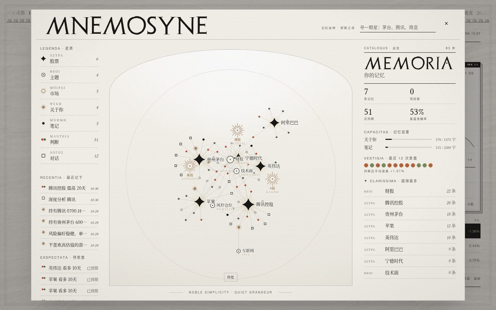
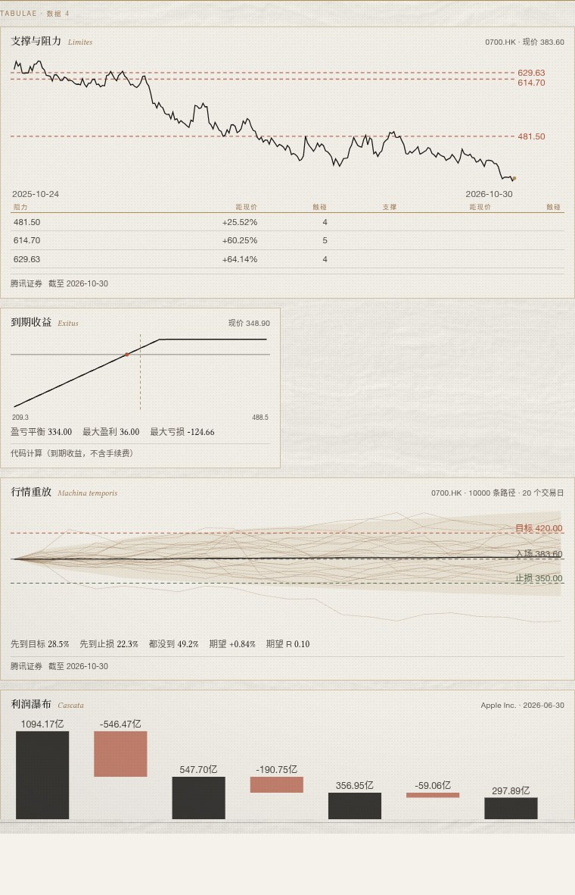
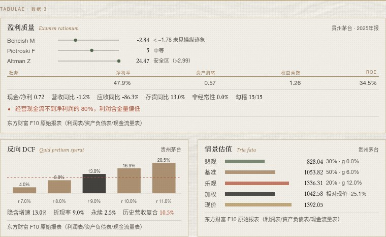

<div align="center">


# Stoa

**有记忆的股市 Agent，覆盖 A股、港股、美股。**

查行情、读公告财报、做多空辩论、写早晚报，并记住你的持仓和每一次判断。

A stock-market agent with memory for China A-shares, Hong Kong and US stocks — quotes, filings, multi-analyst debate and daily briefings, all remembering your holdings and every call it made.

[](https://github.com/jiuyang5354/Stoa/releases)


[](LICENSE)

[下载 Windows 版](https://github.com/jiuyang5354/Stoa/releases/latest) · [快速开始](#快速开始) · [能做什么](#能做什么) · [外接 API](#外接-api全部兼容) · [回测与评测](#回测与评测v014--probatio)

简体中文 | [English](README.en.md)

</div>

> **English summary**
>
> Stoa is a self-hosted stock-market agent for A-shares, Hong Kong and US stocks. It pulls quotes, news, announcements and financials, runs a multi-role "Agora" debate (four analysts, bull vs. bear, a risk officer and a portfolio manager), cites every number it states, and writes morning and evening briefings pushed to WeChat, WeCom, Feishu or Telegram. It keeps a long-term memory of your holdings, preferences and every call it made, and reviews those calls when they come due. Bring your own model key (20+ presets, plus any OpenAI-compatible, Anthropic or Gemini endpoint). There is no Stoa server: your data stays in a local folder or your own Docker volume.
>
> Runs as a Windows desktop app, a Docker service, or plain Python. Also exposes an OpenAI-compatible API and an MCP server. Licensed under MIT. See the [full English README](README.en.md).

<p align="center"></p>

## 当前状态

- 公开测试版，更新很快，每个版本做了什么见 [Releases](https://github.com/jiuyang5354/Stoa/releases)。
- 看多、看空这类择时判断在回测里**不具统计显著性**，表现接近简单动量。Stoa 更适合查资料、看风险、写早晚报，不要拿它的方向判断直接下单。
- Windows 自绘标题栏的拖动、缩放和一键更新还缺真机反馈，遇到问题欢迎提 [Issue](https://github.com/jiuyang5354/Stoa/issues)。
- **仅供参考，不构成投资建议。**

## 快速开始

| 方式 | 适合 | 怎么做 |
|---|---|---|
| Windows 安装包 | 只想用 | 下载 [Stoa-Setup.exe](https://github.com/jiuyang5354/Stoa/releases/latest)，双击安装，桌面出现 Stoa 快捷方式（也有绿色版 Stoa-Windows.zip） |
| Docker 常驻 | 24 小时在线、推送早晚报 | `cp .env.example .env` 填模型密钥，`docker compose up -d`，打开 http://localhost:8080 |
| Python | 开发、命令行 | `pip install -r requirements.txt`，`python -m stock_agent serve` |

第一次发消息时如果还没配模型，会自动打开「设置 → 模型」。看行情和早晚报不需要模型。

常用操作：输入框打 `/` 弹出命令（`/deep 腾讯` 深度分析、`/news`、`/compare`、`/risk`、`/alert` 等）；顶部 History（Ctrl+J）看旧对话，Ledger（Ctrl+L）看判断账本与记忆，Graph（Ctrl+G）看记忆图谱。

<p align="center"></p>

## 能做什么

- 指数：上证、深证成指、创业板指、恒生、恒生科技、标普500、纳斯达克、道琼斯
- 自选股：在 `config.yaml` 里随便加
- 每只标的：收盘、单日 / 5 日 / 20 日涨跌、RSI、20/60 日均线
- 公司事件与筹码（v0.23）：A股限售解禁（未来 180 天、占总股本）、业绩预告、机构调研、股东增减持、回购进度、股权质押、融资融券、股东户数；涨停/炸板/跌停与连板梯队、行业与概念板块资金；美股 SEC Form 4 高管买卖、FINRA 日空头成交占比。行情里带 A股涨跌停价、T+1 与一手股数
- 国内网络可用（v0.24）：行情默认走腾讯证券、东方财富，页面字体和 3D 资源随程序本地分发，不连外网 CDN；对话随时可停（Stop 按钮或 Esc），后台模型和工具在下一步前收手
- 内置投研流程（v0.23）：个股体检、事件排雷、盘后复盘、策略回测（按 T+1、手续费、印花税、滑点、涨跌停）、选股筛选、财报季研判，Agent 遇到同类问题先按流程查数据再下结论；可以同名覆盖成自己的版本
- 对话里实时显示每一步在查什么（查行情、读公告…），同一轮的多个查询并行跑，答完收成「N 步 · 秒数」可展开看耗时
- 研究资料（v0.7，免密钥）：个股新闻（东方财富 + Yahoo）、公司公告（东方财富公告中心、美股 SEC EDGAR）、财报与估值（东方财富 F10 + Yahoo Finance）、联网搜索（DuckDuckGo / Bing，可选 Tavily、Brave）、读网页正文
- 记忆图谱（v0.12，v0.13 改为简约神殿风：象牙白拱门、顶光与一圈淡金光环，股票是星，每个主题由掌管它的神守护——财报是雅典娜、AI 是普罗米修斯、降息是克洛诺斯，三个市场是命运三女神）：左上 Graph / Ctrl+G / 输入 /graph。把 USER/MEMORY 条目、技能、判断账本、网页对话按股票、主题（板块与宏观词表）、市场串成力导向图；点股票看相关记忆、对话和判断对错战绩，一键「问 Stoa」。Agent 新工具 memory_links：分析前顺着图谱一次取齐相关记忆。接口 GET /api/graph。全部规则抽取，不调模型
- MCP 客户端（v0.11）：设置 → MCP 服务器，接入本地命令（stdio，如 `uvx mcp-server-fetch`、`npx -y @modelcontextprotocol/server-filesystem`）或远程 URL（Streamable HTTP，/sse 结尾走旧版 SSE），工具在对话里直接可用（mcp__服务器__工具）。可粘贴 Claude Desktop / Cursor 的 mcpServers 配置导入，逐个工具开关；配置存数据目录 mcp.json，`${变量}` 读 .env；失败的服务器 5 分钟内不重试；MCP_TIMEOUT 默认 60 秒
- 多会话（v0.10）：左上角 History（Ctrl+J）打开对话历史，新建、切换、搜索（v0.17 起关键词 + 语义）、置顶、改名、删除；重启后接着聊旧对话，Stoa 带回「会话纪要 + 最近的原文」作为上下文（v0.17 起不再简单截断成最近 40 条）；输入 /new 新建
- 自动更新（v0.9）：启动时检查 GitHub 新版本，设置 → 数据与关于 →「更新并重启」一键换新（数据不动，STOA_UPDATE=off 关闭）；每次发版先在 GitHub 的 Windows 机器上真机自检（双击 Stoa.exe、开独立窗口、静默卸载），过了才挂包
- 价格预警与公告提醒（v0.9）：对话里说「腾讯跌破 450 提醒我」就设好；支持涨到/跌到某价、单日涨跌超某百分比、有新公告；自选股默认有新公告就提醒；约每 5 分钟检查（ALERT_INTERVAL），推到已开的渠道，网页开着会弹出提示
- 记忆会整理（v0.8）：每条记忆带日期，快满时自动合并去重（改写前备份）；做完多步骤分析会把做法存成技能，下次照着做；判断账本按方向、市场、周期统计准确率，找出短板
- 多角色深度分析（v0.15 · Agora）：问「深度分析 X」「该不该买 X」时，四位分析师并行取数 → 多空研究员辩论 → 风控官查你的持仓集中度与止损（可否决）→ 基金经理给出 看多/看空/中性 + 置信度 + 关键依据 + 失效条件，自动记账；网页可展开「辩论纪要」
- 数字强制引用（v0.15 · Citatio）：工具数据带来源与时间戳，回答里的价格、涨跌幅、财务数字后面有 [n] 角标（可悬停、点开原链接），末尾列来源；找不到出处的数字会被打回重写，仍不改就标「未核实」
- 语义记忆 + 长对话压缩 + 财报事件（v0.17）：换个说法也能想起以前说过的话（「离场价」能找到「止损 455」），关键词 + 向量混合检索；对话长了自动把较早的部分滚动摘要成会话纪要，关键数字和你的决定原样保留、带当时的来源；跟踪持仓与自选股的财报日，财报前提醒，财报一出自动写事件研报（实际 vs 一致预期、同比、管理层指引、和你的持仓逻辑对照：加强 / 削弱 / 被证伪）。详见下文
- 更深的数据 + 年报（v0.16）：A股主力/超大单资金流、北向资金、龙虎榜席位、分析师一致预期（目标价区间、评级分布、EPS 预测）、近 1–5 日分钟线、美股期权（隐含波动率、Put/Call、最大痛点）；能读 A股/港股年报 PDF 和美股 10-K，按章节检索段落、对比两年风险因素变化，角标直接跳到 PDF 对应页；报价等关键数字两个数据源交叉校验，差异过大会在回答里如实说明。详见下文
- 回测与评测（v0.14 · Probatio）：时间穿越回测（严格屏蔽未来数据，分市场的方向胜率、置信度校准、多空组合 vs 买入持有 vs 随机 / 一直看多 / 动量基线）+ 32 道固定评测题（报价准确、拒绝编造、风控、记忆、工具选择），没有大模型密钥也能跑，详见下文
- 风控红线 + 大横截面排序 + 新闻前瞻采集（v0.19）：无持仓时风控只查红线、默认通过；`--universe csi300` 从沪深 300 历史成分抽 100 只做排序评估（行业中性 IC）；`news-snapshot` 每天把自选股/指数新闻带抓取时间落盘，给将来的无前视回测；Agora 结论页改为「查证要点 + 风险清单」在前。
- 相对强弱排序 + point-in-time 公告/财报（v0.18）：回测新增 `--mode rank`（同一批股票每天一次打分，Rank IC / ICIR / 头尾多空，对照动量、反转、随机），`--with-events` 只给决策日之前已发布的公告与已披露财报做消融；Agora 风控降级改为按比例收拢置信度。
- 信号：单日大涨大跌、RSI 超买超卖、上穿 / 跌破 20 日线、52 周新高新低
- AI 点评与对话：DeepSeek、通义、Kimi、智谱、豆包、Claude、Gemini、Ollama 等二十多家模型，行情源可接 Tushare、Twelve Data 等，对外提供 OpenAI 兼容接口和 MCP
- 定时：GitHub Actions 每个工作日北京时间 08:30、21:00 自动跑，报告存进 `reports/`

## Windows 绿色版（不用 Docker、不用装 Python）

到 [Releases](https://github.com/jiuyang5354/Stoa/releases) 下载 `Stoa-Setup.exe` 双击安装（装到 `%LOCALAPPDATA%\Programs\Stoa`，不需要管理员，自动建桌面和开始菜单快捷方式，装完直接打开；卸载在「设置 → 应用」里，数据保留）。也可以下绿色版 `Stoa-Windows.zip` 解压后双击 `Stoa.exe`：自带嵌入式 Python 3.12 和全部依赖，双击直接打开独立的 Stoa 窗口（Windows 自带 WebView2 内核，不开浏览器、无控制台）。第一次运行不弹任何窗口；发第一句话时如果还没配模型，会自动打开「设置 → 模型」，选服务商、填密钥，保存立即生效、不用重启（看行情和早晚报不需要模型）。窗口用和界面同风格的自绘标题栏（Windows 11 圆角阴影，拖动、贴靠、双击最大化照常；设环境变量 `STOA_FRAME=native` 可换回系统标题栏）。关窗口即退出，日志在 `%LOCALAPPDATA%\Stoa\stoa.log`。数据在 `%LOCALAPPDATA%\Stoa`，换新版不丢。右上角 Settings（或 Ctrl+,）里能改模型和密钥、管理记忆和自选股、开推送渠道、调早晚报时间、导出备份，保存立即生效。卸载就双击包里的 `卸载 Stoa.exe`，可选是否连数据一起删。

自己打包：在 Linux 上运行 `packaging/windows/build.sh`（需要 mingw-w64），产物在 `dist/`。其它系统也能用 `python -m stock_agent desktop` 得到同样的桌面模式。

## 一键部署：独立沙箱常驻运行（推荐）

像 Hermes Agent 一样跑成一个常驻智能体：装进 Docker 隔离沙箱，24 小时在线，记忆存在挂载卷里，重启、升级都不会丢。

```bash
git clone https://github.com/jiuyang5354/Stoa.git && cd Stoa
cp .env.example .env        # 填 LLM_PROVIDER 和 LLM_API_KEY，其余按需
docker compose up -d
```

打开 http://localhost:8080 就能聊天：顶部滚动行情条，右侧可切换 A股/港股/美股 的走势卡片（悬停看每日点位）和它记住的你。界面控件参考 21st.dev（Ticker、Market Snapshot、Sparkline、AI Chat Input、Suggestions、Text Dots），原生重写，无需前端构建。

容器里同时跑着：

- **网页聊天**：带记忆面板；放到服务器上设置 `WEB_TOKEN`，用 `http://host:8080/?token=口令` 访问
- **Telegram 网关**（可选）：填 `TELEGRAM_BOT_TOKEN` 和 `TELEGRAM_CHAT_ID`，只回复白名单里的人
- **定时早晚报**：工作日 08:30 / 21:00（北京时间，`REPORT_TIMES` 可改），推送到已配置的渠道
- **沙箱代码执行**：`ALLOW_CODE=1` 时 Agent 可以自己写 Python 做回测、算相关性等分析

所有渠道共享同一套记忆。闲置 30 分钟自动结束会话并整理记忆；聊天里发 `/new` 立刻整理并开新对话，`/memory` 查看记忆。

**沙箱隔离**

| 措施 | 说明 |
|---|---|
| 非 root 用户 | 容器内以 uid 10001 运行 |
| 只读根文件系统 | 只有 `/data` 和 `/tmp`（256 MB 内存盘）可写 |
| 去掉全部 Linux capabilities | `cap_drop: ALL` + `no-new-privileges` |
| 资源上限 | 1.5 CPU、1.5 GB 内存、256 个进程 |
| 代码执行再隔离 | 独立子进程、60 秒超时、1 GB 内存上限、看不到任何密钥环境变量 |
| 端口只绑本机 | 默认 `127.0.0.1:8080`，对外暴露需自己配 |

数据都在 Docker 卷 `agent-data`（容器内 `/data`）：`memory/`（记忆）、`data/sessions.db`（对话与判断账本）、`config.yaml`（自选股）、`reports/`、`workspace/`（沙箱文件）。备份：`docker cp stoa:/data ./backup`。

## 外接 API（全部兼容）

运行 `python -m stock_agent providers` 查看当前用的模型和行情源。

**大模型**：`.env` 里设 `LLM_PROVIDER` + `LLM_API_KEY` 就行，工具调用在各家之间自动转换。

| 协议 | 预设 |
|---|---|
| OpenAI 兼容 | deepseek · openai · qwen（通义）· kimi · zhipu（智谱）· doubao（豆包）· hunyuan · minimax · stepfun · baichuan · siliconflow · openrouter · groq · together · fireworks · mistral · xai · perplexity |
| 本地 | ollama · lmstudio · vllm |
| 原生 | anthropic（Claude）· gemini · azure |

输入框打 `/` 弹出命令：执行模式 `/deep 腾讯`（Agora 深度分析）、`/quick`（快问）、`/news`、`/earnings`、`/compare`、`/risk`、`/review`、`/brief`、`/remember`、`/alert`；界面 `/new`、`/history`、`/ledger`、`/graph`、`/backtest`、`/model`、`/settings`、`/memory`。↑↓ 选、Tab 补全、Enter 执行。

右侧栏：指数走势、市场脉搏（5 日 / 20 日涨跌、距一年高点、年化波动）和 A股 / 港股 / 美股要闻，左边缘可以拖动调宽度、双击还原；判断账本、财报事件、关于你、笔记在顶部「Ledger」（Ctrl+L）。

任何别的服务（中转站、One API、自建网关、公司内网模型）：在「设置 → 模型 → 自定义来源」填名称、地址、密钥，选 OpenAI 兼容 / Anthropic / Gemini 协议，点「检测」能列出它有哪些模型；保存后在「服务商」里选它。也可以只填 `LLM_BASE_URL`。模型框会自动问服务商要模型列表，点「选择」挑一个。`LLM_FALLBACK=qwen,ollama:qwen2.5:7b` 让主模型挂了自动换。

中转站示例（以 sui-xiang.com 为例，任何 `/v1/chat/completions` + function calling 的中转都一样）：

```ini
LLM_PROVIDER=openai
LLM_BASE_URL=https://sui-xiang.com/v1
LLM_MODEL=gpt-6.1-terra        # 填中转后台里你的分组能用的模型名
LLM_API_KEY=sk-...             # 中转给你的密钥
LLM_CONTEXT=200000             # 中转不报窗口大小，按模型实际窗口填，长对话压缩按它定预算
EMBEDDINGS=local               # 中转没有 /v1/embeddings 时用本地向量，省得每次先失败再回退
LLM_RETRIES=5                  # 中转限流（429）/网关 5xx 时退避重试次数，默认 3
```

中转常限并发：回测 `--concurrency 1–2`，辩论回测慢时加 `--role-timeout 120`。

**行情源**：`DATA_PROVIDERS` 按顺序尝试，默认 `tencent,eastmoney,akshare,yahoo`（免费、免密钥；腾讯证券、东方财富、新浪财经（经 AKShare）都是国内网络直连，A股/港股/美股和主要指数都有，Yahoo 只做兜底）。交易时段右栏每分钟用新浪批量实时报价刷新 A股和港股。

| 源 | A股 | 港股 | 美股 | 指数 | 密钥 |
|---|---|---|---|---|---|
| tushare | ✓ | ✓* | ✓* | A股指数 | TUSHARE_TOKEN |
| twelvedata | ✓* | ✓* | ✓ | ✓ | TWELVEDATA_API_KEY |
| alphavantage | ✓ | ✓ | ✓ | – | ALPHAVANTAGE_API_KEY |
| finnhub | ✓* | ✓* | ✓* | – | FINNHUB_API_KEY |
| polygon | – | – | ✓ | 美股* | POLYGON_API_KEY |
| fmp | ✓* | ✓* | ✓ | ✓* | FMP_API_KEY |
| tiingo | – | – | ✓ | – | TIINGO_API_KEY |
| custom | 自建接口 `DATA_CUSTOM_URL` | | | | 可选 |

\* 需要对应套餐的权限。比如 A股为主可以写 `DATA_PROVIDERS=tushare,tencent,eastmoney`。

**对外接口**（`serve` 模式，口令用 `Authorization: Bearer <WEB_TOKEN>`）：

- OpenAI 兼容：`http://host:8080/v1`，模型名 `stoa`。Cherry Studio、LobeChat、NextChat、Open WebUI、沉浸式翻译这类能填自定义 OpenAI 地址的软件都能直接把它当模型用，记忆照样生效。
- MCP：远程填 `http://host:8080/mcp`；本地 Claude Desktop / Cursor 配置：
  ```json
  {"mcpServers": {"stoa": {"command": "python", "args": ["-m", "stock_agent", "mcp"], "cwd": "/path/to/stoa", "env": {"LLM_PROVIDER": "deepseek", "LLM_API_KEY": "sk-..."}}}}
  ```
  提供 get_quotes、market_overview、get_news、get_announcements、get_financials、web_search、fetch_url、memory、session_search、watchlist、record_call、call_stats，配了大模型还有 ask_agent。
- REST：`POST /api/chat` `{"text","session"}`、`GET /api/indices`、`GET /api/memory`、`GET /api/report`。

**推送**：Telegram、Server酱、PushPlus、企业微信、飞书、钉钉、Bark、ntfy、Discord、Slack、通用 Webhook，填哪个推哪个。

## 记忆（参考 Hermes Agent）

和它聊得越多，它越懂你：

| 层 | 文件 | 存什么 |
|---|---|---|
| 用户画像 | `memory/USER.md`（上限 1375 字） | 持仓与成本、风险偏好、投资风格、关注板块、沟通习惯 |
| Agent 笔记 | `memory/MEMORY.md`（上限 2200 字） | 复盘得出的经验、对个股的长期观察、你纠正过它的地方 |
| 对话检索 | `data/sessions.db`（SQLite FTS5 + v0.17 语义向量） | 所有历史对话，「上次说过的」能搜回来，换个说法也行 |
| 会话纪要 | `data/sessions.db` 的 session_digest 表（v0.17） | 长对话较早部分的滚动摘要 + 关键数字与用户决定（带来源） |
| 判断账本 | `data/sessions.db` 的 calls 表 | 它给出的每个看涨/看跌判断，到期自动对照现价打分 |

- 两份记忆每次对话都自动注入；满了必须合并精简，不会无限膨胀。
- Agent 自己决定存什么：你透露持仓、偏好时当场写入；每 6 轮提醒自己回顾一次；退出时再整理一遍。
- **学习闭环**：判断到期后自动复盘，判断错了就把教训写进 MEMORY.md，下次带着教训分析。
- 早晚报的 AI 点评也会读这两份记忆，结合你的持仓来写。
- 记忆是纯文本，随时可以手动改；持仓属于隐私，建议仓库设为 Private。

```bash
python -m stock_agent chat     # 对话（需要 LLM_API_KEY），/memory 查看记忆，/exit 退出并整理记忆
python -m stock_agent serve    # 常驻模式（网页 + Telegram + 定时报告），不用 Docker 也能跑
python -m stock_agent memory   # 打印当前记忆
python -m stock_agent memory reindex       # 重建语义索引（v0.17；平时增量自动建）
python -m stock_agent memory search 离场价  # 试一下混合检索
python -m stock_agent earnings             # 持仓与自选股的财报日历（refresh 立即刷新，report 0700.HK 手动出研报）
python -m stock_agent review   # 手动复盘到期的判断
```

对话里能做的：查行情和技术指标、看新闻和公告、查财报估值、联网搜索并读原文、增删自选股、记住你的持仓、搜以前聊过的内容、给判断并记账、看历史胜率。

## 多角色深度分析（v0.15 · Agora）

普通快问（价格、涨跌、某个指标）仍是一个 Agent 一问一答。问「深度分析一下腾讯」「我该不该买英伟达」「茅台值不值得买」时，Stoa 开一场小型投研会：

1. **分析师（并行）**：基本面（`get_financials`）、技术面（`get_quotes`）、消息与情绪（`get_news` + `get_announcements`）、宏观与行业（`market_overview` + `web_search`），各自只看自己的数据，写一份带证据的短报告（判断 + 置信度 + 3 条证据）。
2. **多空辩论**：多方研究员 vs 空方研究员，第 1 轮各自立论，之后每轮逐条反驳对方上一轮（`rounds` 1–3）。
3. **风控官**（v0.19 起）：先跑**红线规则**——停牌/数据中断（最后一根 K 线距今 >6 个工作日）、ST/退市、流动性不足（有成交额数据时，日均 <1000 万）、极端波动（20 日年化波动 ≥150% 否决、≥80% 降级）、单日涨跌 ≥15%、提问或持仓涉及杠杆/融资/借钱。**没有持仓/仓位/风险偏好信息时只做红线检查，默认通过，不请模型**；有持仓时再按规则（单票仓位 ≥40% 否决加仓、25–40% 降级、组合里另有重仓、保守偏好仓位上限 10%）+ 模型判断，模型只能比规则更严，但**没有命中红线就不能否决**（最多降级）。否决时不能给看多，降级时置信度按比例向 50 收拢。
4. **基金经理**：给出倾向（看多 / 看空 / 中性）+ 置信度 + 关键依据 + 「什么情况下结论失效」，自动 `record_call` 进判断账本，到期复盘。

**结论页 = 查证要点 + 风险清单**（v0.19）：方向判断经回测不具统计显著性，所以答案和网页纪要把能核对的东西放在前面——「查证要点」（每条依据带出处角标，没出处的标「待核」，并列出哪些角色没拿到数据）、「风险清单」（红线 → 风控发现 → 空方论点 → 失效条件，附仓位上限与止损），倾向与置信度降为一行次要信息，辩论过程折叠。

**预算与降级**：每次最多调用模型 `max_calls` 次、估算 token 不超过 `max_tokens`、每个角色 `role_timeout` 秒（`config.yaml` 的 `debate:` 段，或 `DEBATE_ROUNDS / DEBATE_MAX_CALLS / DEBATE_MAX_TOKENS / DEBATE_ROLE_TIMEOUT`）。哪个角色失败、超时或撞上预算，就降级为规则摘要（基金经理降级时按分析师投票），整场不会因为一个角色失败而失败，答案里会写明谁降级了。

每场辩论存 `data/debates/<id>.json`（每个角色的状态、用时、取了哪些数据、输出、未核实的数字、预算用量，以及 checklist / risks 两张清单）。网页答案下方有「AGORA」按钮，展开依次是 I 查证要点、II 风险清单、III 倾向（小字），分析师四宫格与逐轮交锋收在「辩论过程」里。接口：`GET /api/debates`、`GET /api/debates/<id>`；模型也可以自己调用 `deep_analysis` 工具。

**回测**：`python -m stock_agent backtest --agent debate [--rounds 2] [--max-calls 600]`。回测版辩论只给技术面分析师截断后的行情（盲测），基本面 / 消息 / 宏观三位分析师禁用、风控只看波动、不记账，和 baseline / llm 单轮用同一套打分直接对比。没有密钥时 `--llm mock` 用规则扮演各角色，只验证管线（mock 结果等同规则 Agent）。

## 数字强制引用（v0.15 · Citatio）

- 每个工具结果登记来源：行情（数据源名 + 行情页链接 + 数据日期）、财报（来源 + 链接）、每条新闻 / 公告 / 搜索结果（标题 + 原文链接 + 时间）、记忆与账本。交给模型的数据里带 `_cite` 编号，模型在关键数字后写 [n]。
- **核对器**（`stock_agent/cite.py`）：从最终回答里抽出价格、涨跌幅、财务数字（跳过日期、天数、股数、代码、小整数），和本轮工具数据比对——四舍五入、万/亿换算、小数↔百分数、两数之差、涨跌幅、股数×差价都算有出处。
- 找不到出处的数字：自动让模型修正一次；还不行就在数字后标「未核实」并在文末提示。有出处但模型没标的数字自动补角标，按出现顺序重新编号，末尾附「—— 来源 ——」清单。
- 网页把 [n] 渲染成小角标：悬停看来源名、数据时间和链接，点击打开原文。

## 更深的数据 + 年报（v0.16）

全部免密钥。每个工具都带 **来源名、链接、数据时间**，接入引用角标；每个尝试过的数据源成败都列在结果里，**多源数字差异过大时写 warning**，回答里必须告诉你「两个数据源不一致」而不是挑一个当真。

| 工具 | 数据 | 数据源（主 → 备 / 交叉校验） |
|---|---|---|
| `get_fund_flow` | A股个股主力 / 超大单净流入（日级，近 N 日，亿元）、5 日合计 | 东方财富资金流 → 新浪财经历史资金流 → 东方财富当日分时；两源重叠日期比对（两家「主力」口径不同，阈值放宽到 35%） |
| `get_northbound` | 北向成交总额、个股北向持股与变化 | 东方财富数据中心。**2024-08-19 起交易所不再披露北向每日净买入**，个股持股改为季度披露——拿不到的字段返回 null 并说明 |
| `get_dragon_tiger` | 龙虎榜：上榜日期、原因、净买额、买入/卖出前五席位 | 东方财富数据中心；很久没上榜会如实说明 |
| `get_consensus` | 目标价区间 / 均值、相对现价空间、评级分布、EPS 预测、近一年研报 | A股：东方财富盈利预测 + 研报列表 + Yahoo；美股：Yahoo + Nasdaq；港股：Yahoo（EPS 币种与股价不同会提示） |
| `get_intraday` | 近 1–5 日分钟 K 线摘要：开高低收、高低点时刻、VWAP、走势点 | Yahoo chart → 东方财富分钟线 → 腾讯分时（A/港，当日），各源最新价比对 |
| `get_options` | 美股期权：最近到期 + 约 30 天到期的 ATM 隐含波动率、Put/Call 比、最大痛点 | Yahoo options（yfinance）→ Nasdaq 期权链（无 IV）；Put/Call 与最大痛点两源比对 |
| `get_quotes`（增强） | 日线收盘之外再拿新浪 / 腾讯 / Yahoo 实时报价比对 | 偏差超过 `QUOTE_DIFF_PCT`（默认 0.5%）写 warning；`QUOTE_CROSSCHECK=off` 关闭 |
| `read_filing` | 年报 / 季报 / 10-K 段落：按章节（管理层讨论与分析、风险因素、主要财务数据、分部收入）定位 + 关键词 BM25 选段，每段带页码 | A股巨潮资讯（失败退东方财富公告 PDF）、港股披露易、美股 SEC EDGAR |
| `compare_filings` | 两年同一章节的新增 / 删除 / 改写句子（带页码）+ 数量统计 | 同上 |

**年报解析**（`stock_agent/filings.py`）：PDF 用 pypdf 抽文本（纯 Python，已进主依赖，Windows 包增加约 1 MB）；港股中文年报常见字体没有编码映射、抽出来是乱码——装了 `pdfminer.six`（可选，`requirements-dev.txt`）就用它重抽乱码页，没装就自动改读英文版。两个库都没有时返回原文链接并提示安装。跳过目录页，章节到下一章（第 X 节 / Item N / 同级小节标号）为止。缓存在 `数据目录/data/filings/`，首次下载解析约 5–20 秒，之后秒开。回答里写「第 N 页」会自动挂上角标，点开就是 `PDF#page=N`（SEC 的 HTML 用文本片段链接定位）。

**深度分析接入**：技术面分析师另看 A股资金流 / 美股期权，消息情绪分析师另看龙虎榜，基本面分析师另看一致预期和最近两年年报风险因素对比（限时 `DEBATE_FILING_TIMEOUT` 默认 25 秒，首次下载超时就跳过、后台继续缓存；`DEBATE_FILINGS=off` 关闭）。

**网页**：答案下方的「Tabulae · 数据」小卡：资金流柱（细线 = 超大单）、一致预期区间条（金线区间、菱形均值、黑线现价）、分时线（虚线 = 昨收、点线 = VWAP）、期权表、北向与龙虎榜表、年报段落（P. N 直达 PDF 页）、年报对比（＋新增 / －删除）、报价校验；每张卡写来源、截至时间，有校验问题时用赤陶色小注标出。接口 `GET /api/cards/<id>`、`GET /api/filings`。

**回测**：这些新数据默认在回测里一律禁用（`backtest.BT_TOOL_POLICY`）：一致预期、期权、分钟线只有当前快照，北向持股与龙虎榜的披露时点无法逐条确认。唯一例外是资金流历史日线——能按日期严格截断，加 `--with-flow` 才给辩论的技术面分析师，且只给主力净占比（盲测不暴露成交规模），测试里证明每个决策点用到的资金流最后日期都等于决策日。

## 语义记忆 · 长对话压缩 · 财报事件（v0.17）

**语义记忆**（`stock_agent/vectors.py`）：历史对话、会话纪要、USER.md / MEMORY.md 条目、判断账本的理由、Agora 辩论纪要摘要都建了向量索引（存 `sessions.db` 的 `mem_items` / `mem_vecs`，float32 blob），检索时 BM25 关键词和向量余弦各取前 50，用 RRF（k=60）融合。

- 嵌入后端可插拔：`EMBEDDINGS=auto`（默认）时，已配置的模型服务商有 OpenAI 兼容 `/embeddings` 就用它（openai、qwen 通义、zhipu 智谱、siliconflow、mistral、together、fireworks、ollama、lmstudio、vllm、hunyuan；见 `providers.EMBED_MODELS`），没有（如 deepseek、kimi、Claude、Gemini 原生）或没密钥就用**本地向量**：中文按字 + 双字、英文按词，哈希到 1024 维的 TF-IDF 向量，外加概念词——股票名字/代码归一（腾讯 = 腾讯控股 = 0700.HK）、图谱主题词表（芯片 ≈ 半导体）、一张金融同义词表（止损 ≈ 离场价 ≈ 割肉、成本 ≈ 买入价、偏好 ≈ 态度…）。纯 numpy，不装 torch，Windows 包大小不变。也可单独指定 `EMBED_PROVIDER` / `EMBED_MODEL` / `EMBED_BASE_URL` / `EMBED_API_KEY`；`EMBEDDINGS=local` 只用本地，`off` 只用关键词。远端失败自动退回本地，10 分钟内不再重试。
- 增量建索引：每次检索前只补新消息和变化的条目，`serve` 里还有后台线程每 2 分钟补一次；`python -m stock_agent memory reindex` 全量重建。
- Agent 的 `session_search` 改走混合检索，新增 `search_memory`（可限定 用户画像 / 笔记 / 判断 / 辩论 / 对话 / 纪要）；`memory_links` 在规则图谱之外补上「语义相关」，规则匹配仍是兜底。

**长对话压缩**（`stock_agent/context.py`）：按模型上下文窗口算预算（`providers.CONTEXT`，没列的默认 32k，`LLM_CONTEXT` 覆盖；预算 = 窗口 × `CONTEXT_RATIO` 默认 0.6 − 工具定义，或直接设 `CONTEXT_BUDGET`）。token 有 tiktoken 就用，没有就按字符估（中文 ≈ 1 字 1 token）。

- 超预算时把较早的消息滚动摘要成「会话纪要」，保留最近几轮原文 + 纪要 + **关键数字与用户决定**（规则抽取，原话保留，助手说过的数字附上当时的来源名和截至时间）；纪要由模型写，没模型或失败时用规则摘要。恢复旧对话时读纪要 + 纪要之后的原文，原文超过 40 条或超预算就继续滚动摘要。
- 纪要也登记为引用来源：压缩后复述早先的数字照样有角标，不会被核对器误判为编造。
- 工具结果过长时按结构收缩（列表取前几条、长文本截断），`_cite`、链接、来源、时间、warnings 原样保留，不再从 JSON 中间硬切。
- 工具循环轮数按预算动态：上限 `config.yaml` 的 `agent.max_tool_rounds`（默认 12，`AGENT_MAX_ROUNDS` 覆盖），上下文预算先用完也会收尾——最后一轮不给工具，让模型基于已拿到的结果作答并说明没查到什么。

**财报事件**（`stock_agent/earnings.py`）：跟踪 USER.md 里的持仓 + 自选股的财报日（A股 东方财富「业绩预约披露」，美股/港股 Yahoo earnings dates），存 `data/events.json`，复用提醒的常驻线程，日历 12 小时刷新一次。

- 财报前 `earnings.remind_days`（默认 3）天推一条提醒：日期、市场预期（EPS 一致预期、目标价区间）、你上次对它的判断与理由。
- 财报发布后（确认已披露，或已过财报日一天，5 天内）自动生成事件研报 `data/reports/events/<代码>-<日期>.md`：实际 vs 一致预期（美/港：季度 EPS；A股：累计 EPS 占全年一致预期的完成度 vs 去年同期完成度）、关键指标同比、管理层指引（财报前后提到指引/展望的公告与新闻；有模型时据此概括）、和你的持仓逻辑对照（USER.md 持仓、账本里该股的历史判断理由、最近一次 Agora 结论）——**加强 / 削弱 / 被证伪 / 基本不变**，规则先判，模型只能改得更保守，且不得出现数据里没有的数字。`earnings.debate: true` 时顺带跑一次 Agora 辩论。
- 推送到已开的渠道（Telegram 等），网页弹出提示并在右栏「Eventus · 财报事件」列出将至的财报日和研报，点开是研报全文（来源角标、原文链接）。对话里也可以直接问「腾讯财报出来了，帮我做个事件研报」（工具 `earnings_report`）或「我的持仓什么时候出财报」（`earnings_calendar`）。
- 接口：`GET /api/events`、`GET /api/events/report/<id>`、`POST /api/events/check`（仅本机）、`GET /api/memory/search?q=`。`EARNINGS=off` 关闭。

**网页**：对话里较早的部分归档后，会出现一条克制的「此前 N 条对话已归档为纪要」金线分隔，点开看纪要；记忆图谱多了金色点线（意思相近的记忆之间的语义边），搜索框在规则没命中时给出「Reminiscentia · 回想」语义结果；History 搜索里语义命中的对话标「≈ 语义」。

## 数字硬算 · 对话内出图 · 行情重放（v0.26 · Ratio）

派生数字不再让模型心算：占比、增速、差额、利润率一律走 `calc`，回答引用计算结果。新增四个确定性工具，结果在回答下方直接画图：

| 工具 | 做什么 |
|---|---|
| `price_levels` | 按历史收盘价摆动点聚类出支撑/阻力位（触碰次数、距现价%），走势图上标出 |
| `financial_bridge` | 最近一期 营收 → 成本 → 毛利 → 费用 → 净利 瀑布图，附毛利率/净利率/同比 |
| `option_payoff` | 期权/正股组合到期收益曲线、盈亏平衡、最大盈亏 |
| `trade_replay` | 行情重放：用近几年日收益分块重抽样 1 万条路径，看计划先碰目标还是先碰止损，附期望 R 和路径扇形图 |

新内置技能：`trade-replay`（交易计划压力测试）、`equity-deep-dive`（深度研报）、`crowd-pulse`（舆情 + 资金是否同向）、`options-strategy`（期权组合）。斜杠命令 `/levels` `/bridge` `/replay` `/research` `/pulse`。行情重放是用历史波动做的压力测试，不是预测。



## 判断成绩单 · 战报长图 · 浅石开场（v0.31 · Rationes）

- **判断事后打分**：到期日按收盘结算，对照沪深300 / 恒指 / 标普500 算超额，记录最大浮盈浮亏、方向分和置信度校准（设置 → 记忆 → Ratio）。
- **Probatio 诚实度**：重叠样本校正、Holm + 缩水夏普，账本准确率带 Wilson 95% 区间。
- **战报长图**：`/poster` 把报告排成 1080×1920 长图，风险放最前。
- **视觉**：一种金五档深浅、等宽数字、图框刻进石面；开场改为浅石板凿刻 STOA，金线描拱，约 1.9 秒。
- **要闻更稳**：搜索失败自动重试并退到东方财富 7×24 快讯 / 新浪财经。

## 彩绘柱廊 · 深色主题 · 更新日志（v0.30 · Porticus）

- **开场换成芝诺**：斯多葛派创始人，Stoa 的名字就来自他讲学的雅典彩绘柱廊。胸像是丹麦国家美术馆 SMK 石膏像馆 KAS745 的公有领域扫描，放进 three.js 搭的多立克柱廊里（额枋刻 ΣΤΟΑ · ΠΟΙΚΙΛΗ），浅色是午后日光，深色是两侧火盆。
- **深色主题 Nox**：玄武岩底、象牙字、烛光金，比例和留白不变。设置 → 通用 → 外观，或 `/theme`；可跟随系统。
- **内置更新日志 Fasti**：设置 → 数据与关于 → 更新日志，或 `/changelog`，可按新增 / 修复 / 改动筛选。
- **切换对话不再打断回答**：每个对话独立运行，切走后台继续写，写完提示；刷新页面也能接上。
- **长程研究用满预算**：问题问完会继续深挖，出错自动重试或暂停，对话里可以续跑。

## 校验器自测 · 数据/推断/未知 · 问章刻度（v0.29 · Probatio）

- **校验器自己也要被校验**：引用检查埋了三类必须失败的错例——数字改一位、涨跌方向反写、日期错一天，检查器拦不住测试就失败。顺带补上两个盲区：比数字时不再忽略正负号，日期会和本轮数据日期核对。
- **数据 / 推断 / 未知**：回答和 Agora 查证要点分三类标注。〔数据〕必须带出处角标，没有就自动降为〔推断〕；查不到的写〔未知〕，不拿推测填空。
- **问章刻度**：对话区滚动条换成刻度尺，每一问一道刻痕，金线是当前视口；悬停浮出那一问，点一下跳过去，按住可拖动。

## 长程研究 · 思路可见 · 中英双语（v0.28 · Inquisitio）

- **长程研究**：`/research 目标 [时长]` 开一个课题，Stoa 自己拆计划、逐步查证、反思、写结论，过程记进账本（Ledger → III Inquisitio），跟踪指标会挂成提醒。旧的深度研报改为 `/dive`。
- **思路可见**：每轮先说一句为什么查，每一步写清查到了什么，模型的推理摘要折叠在回答上方（OpenAI reasoning / Claude thinking / Gemini thought）。
- **中英双语**：设置 → 通用 → 语言，或输入 `/lang`。英文界面下 Agent 和课题用英文回答，早晚报仍是中文。
- **排版**：字号统一到 13px × 1.125ⁿ 一套比例，间距对齐 2px 网格；退场动画、贴底滚动和「回到最新」。

## 原始报表 · 盈利质量 · 反向 DCF（v0.27 · Fundamenta）

深度研报改成专业分析师的做法：从原始报表和监管文件出发，所有比率、评分、估值由代码算。

| 工具 | 做什么 |
|---|---|
| `get_statements` | 三表原始科目（A股东方财富原始报表，累计口径自动拆单季；港美股 Yahoo） |
| `earnings_quality` | 杜邦分解、现金含量、应计比率、应收/存货 vs 营收、非经常性损益、Beneish M-score、Piotroski F-score、Altman Z、报表勾稽检查与红旗 |
| `reverse_dcf` | 现价隐含的未来自由现金流增速，附折现率敏感性和历史增速对照 |
| `dcf_scenarios` | 乐观/基准/悲观三情景估值与概率加权价值（港股自动处理报表与股价币种） |
| `regulatory_letters` | 问询函、关注函、监管措施、处罚及回复；美股 SEC 意见信与公司回复 |

内置技能 `equity-deep-dive` 重写：原始素材 → 驱动因素 → 盈利质量 → 反向 DCF/三情景/可比 → 催化剂、事前验尸、失效条件、跟踪指标；结论写入判断账本到期对账。



## 每日新闻快照（v0.19 · Nuntius）

个股新闻接口只能回溯 1–2 个月，一年前的新闻没法拿来公平回测。Stoa 从现在起每天把自选股和指数的相关新闻**带抓取时间**落盘，积累一份 point-in-time 新闻库：

```bash
python -m stock_agent news-snapshot                      # 抓一次：config.yaml 的自选股 + 指数
python -m stock_agent news-snapshot --symbols 600519.SS,NVDA --limit 20
python -m stock_agent news-snapshot --stats              # 库里有多少、从哪天开始
```

- `serve` / 桌面版常驻时自动每天抓（`NEWS_SNAPSHOT_TIMES=17:30`，北京时间，可写多个如 `08:00,17:30`，`off` 关闭；启动时若当天已过点且没抓过会补一次）。
- 存在 `数据目录/data/news/<代码>.jsonl`（每行一条：抓取时间（带时区）、源给的发布时间、标题、摘要、来源、链接；按链接去重，只追加不改写）和 `snapshots.jsonl`（每次快照的数量与错误）。
- 回测读取用 `newsdaily.asof(代码, 决策日)`：只返回**抓取时间早于决策日 0 点**的条目——以「我们什么时候真的看到它」为准，不信源上可能被改过的发布时间。

## 回测与评测（v0.14 · Probatio）

给 Stoa 的每一次改进一把尺子：同一套题、同一段历史，改前改后各跑一次，看分数变没变。

**时间穿越回测**：回到历史上每个时点，只把截至那天的收盘价给 Agent，让它说 看多 / 看空 / 中性 + 置信度，再用之后 N 个交易日的真实收盘价打分。

```bash
python -m stock_agent backtest                    # 规则 Agent（均线），默认 12 只 A/港/美股，近一年，每 5 个交易日，持有 5/20 日
python -m stock_agent backtest --agent llm --max-calls 200 --concurrency 4
python -m stock_agent backtest --symbols 600519.SS,0700.HK,NVDA --start 2025-06-01 --end 2026-06-01 --step 10 --horizons 5,20
python -m stock_agent backtest --synthetic        # 离线：合成行情跑通管线
python -m stock_agent backtest --mode rank --step 5 --horizons 20,5                 # v0.18 相对强弱排序（每个决策日一次调用，整批打分）
python -m stock_agent backtest --mode rank --universe csi300 --n 100 --group-size 50  # v0.19 沪深 300 历史成分抽 100 只（每组 50 只一次调用，组内百分位合并）
python -m stock_agent backtest --mode rank --with-events --step 5 --horizons 20,5   # 再加 point-in-time 公告与已披露财报（消融）
```

**相对强弱排序（v0.18，`--mode rank`）**：不问单只涨跌，问「同一批股票里谁之后 h 日相对更强」。每个决策日把整批股票（代号每天随机打乱、价格归一化）一次交给模型打 0–100 分，调用量 = 决策日数。指标：每日 Rank IC（Spearman）、市场中性 IC（收益先减同市场均值）、IC 均值 / ICIR、t 检验（朴素 + Newey–West，持有期重叠）、按日移动块自助 95% 区间、头尾各 3 只的多空差；基线：20 日动量、5 日反转、随机（另给 200 个种子的经验分布），以及 60 日动量、低波动；配对检验模型 − 基线的逐日 IC 差，并给出模型分数与各基线的相似度。

**Point-in-time 公告与财报（v0.18，`--with-events`，`stock_agent/pit_events.py`）**：A股 / 港股公告用东方财富公告中心（可翻到多年前），美股用 SEC EDGAR（filingDate）；财报一律按**披露日**而不是报告期（A股 F10 的 NOTICE_DATE、美股 XBRL 的 filed 日期；港股没有披露日字段，用同期业绩公告日，找不到就按上市规则期限保守估计）。只给发布日**严格早于**决策日的条目，盲测时公司名换成「该公司」、年份换成「今年 / 去年」。个股新闻拿不到一年前的：东方财富与新浪的个股资讯只回溯约 1–2 个月，所以排序回测里没有新闻。

- **未来数据屏蔽**：行情序列按决策日截断后才交给 Agent；新闻、公告、财报、联网搜索、记忆、对话检索、判断账本在回测里全部不给。大模型 Agent 默认「盲测」：隐去代码和日期、价格归一化到 100，减少它凭训练记忆「背答案」（`--no-blind` 关闭）。
- **指标**（A股 / 港股 / 美股 分开）：方向胜率（不含中性）、含中性的命中率（中性 = 涨跌在 ±1.5%×√(h/5) 内）、按置信度分组的胜率（校准）、多空组合累计收益、买入持有、最大回撤；同时跑三条基线：随机、一直看多、20 日动量。「全部」组合按市场等额分仓，避免不同交易日历的持有期重复计算。
- **大模型**：同一时点 + 同一标的 + 同一模型只调用一次（缓存在 `data/backtests/llm_cache.db`），`--max-calls` 封顶、`--concurrency` 限并发，结果里有调用数、缓存命中、估算 token 与费用（`--price-in/--price-out` 或 `LLM_PRICE_IN/OUT`，每百万 token 美元）。
- 结果：`data/backtests/<id>.json`；装了 matplotlib（`pip install -r requirements-dev.txt`）还会出一张 `<id>.png`。网页：设置 → 回测与评测，或右栏账本下的「Probatio · 回测」，能看最近一次的核心数字、分市场曲线，并在后台发起新回测。

**评测集**：`stock_agent/evals/cases.yaml` 65 道固定题，覆盖报价准确性（回答里的数字要和工具返回一致）、拒绝编造（问不存在的代码）、风控（不承诺收益、有免责）、记忆（记得持仓，跨会话）、工具选择（该查公告时查公告），v0.15 加了引用（角标与来源清单齐全、核对器能抓出编造数字且不误伤推导出的数字、模型幻觉被打回后改掉）和深度分析（走了辩论、风控否决重仓、保守偏好限仓、快问不走辩论），v0.16 加到 57 题：资金流（含港股不支持、北向净买入停披露、龙虎榜久未上榜要如实说）、一致预期与期权、年报问答（带页码）、年报对比、数据源冲突（两源报价 / 目标价不一致必须说出来）；v0.17 加到 65 题：语义记忆（同义改写能召回止损价、偏好、持仓成本、过去的判断理由）、长对话（人为压小预算触发压缩后，仍记得最早的止损价/目标价，复述早先查到的收盘价带角标且通过核对）、事件研报（有预期对比、同比、持仓逻辑结论，研报文件齐全）。工具返回用固定数据，在临时数据目录里跑真正的 Agent，规则打分。

```bash
python -m stock_agent eval            # 有密钥用当前模型，没有就用 mock 跑通管线（mock 分数不代表模型水平）
python -m stock_agent eval --only 记忆 -v
python -m stock_agent eval --judge    # 另请大模型评委给每题 1–5 分（不计入规则总分）
```

结果存 `data/evals/<id>.json`，摘要追加到 `data/evals/history.jsonl`，输出里会和上一次同模型的分数对比。接口：`GET /api/backtests`、`GET /api/backtests/<id>`（`<id>.png` 为图）、`POST /api/backtest`（后台线程，仅本机或带 WEB_TOKEN）、`GET /api/evals`。

测试：`pip install -r requirements-dev.txt && python -m pytest -q tests`。

### 真实模型基准（2026-10-29/30 · gpt-6.1-terra）

模型 `gpt-6.1-terra`（经 sui-xiang 中转，OpenAI 兼容）；回测区间 2025-09-24 → 2026-09-24，盲测（隐去代码与日期、价格归一化），只给截断行情，持有 5 / 20 个交易日打分。方向胜率不含中性；p 为单边二项检验（vs 50%），区间为按决策日整块自助 95%；多空 / 买入持有为区间累计收益。

| 设置 | 样本（方向） | 5 日方向胜率 | 20 日方向胜率 | 多空累计 | 同口径规则 / 动量20 / 随机 |
|---|---|---|---|---|---|
| 单轮 LLM，12 只每 5 日 | 599（501） | 49.5%（p=0.61，[44.6, 53.9]） | 46.7%（p=0.94） | −14.4% | 52.0% · 52.0% · 50.7%（多空 −10.9% · −2.4% · +10.3%） |
| 辩论 Agora，12 只每 10 日 | 304（209） | 52.2%（p=0.29，[44.9, 59.1]） | 47.8%（p=0.76） | −10.6% | 52.9% · 56.9% · 52.3%（多空 −8.1% · +1.4% · +4.6%） |
| 辩论 + 资金流，A股 4 只每 10 日 | 100（77） | 59.7%（p=0.055，[46.1, 73.1]） | 51.9%（p=0.41） | −3.6% | 56.2% · 63.0% · 43.0%（多空 −1.6% · +16.6% · −11.9%） |

- **结论：没有统计显著的择时能力**。三种方式都不显著高于 50%，也没有跑赢 20 日动量；A股那组看空占多数、同期买入持有 −21.6%，胜率主要来自下跌行情。加资金流后 100 题里 87 题判断不变、0 题反向。辩论与单轮 LLM、与均线规则都 0 题方向相反——模型在只有行情时基本是在复述趋势信号。
- **置信度**：提示词分档后置信度有了分散，但高档并不更准；Brier 均 ≥ 0.25（与恒报 50% 相当或更差），事后校准把它们压回接近 50%。辩论里风控「降级」会把多数 55–60 压到 50。
- **局限**：一年、12 只（A/港/美各 4）、单一模型、盲测且只有行情（无新闻/财报的 point-in-time 数据），样本量下 ±5 个百分点以内的差别都分不出来。

**第三轮（2026-10-30，v0.18）：相对强弱排序 + 公告/财报消融**。同一年、同 12 只，每 5 个工作日一个决策日（53 天），每天一次调用整批打分，看未来 20 日（主）/ 5 日的横截面排序。p 为 Newey–West t 检验（双边），区间为按日移动块自助 95%。

| 方法（未来 20 日） | Rank IC 均值 | 95% 区间 | ICIR | p | 头尾多空 / 期 |
|---|---|---|---|---|---|
| 模型，只有行情 | +0.055 | [−0.049, +0.188] | 0.19 | 0.36 | +1.29%（p=0.20） |
| 模型，行情 + 公告/财报 | −0.005 | [−0.130, +0.106] | −0.02 | 0.93 | +0.58%（p=0.66） |
| 20 日动量 | −0.033 | [−0.137, +0.082] | −0.11 | 0.56 | −0.09% |
| 60 日动量 | +0.044 | [−0.061, +0.150] | 0.15 | 0.43 | +1.64%（p=0.056） |
| 5 日反转 | +0.028 | [−0.061, +0.112] | 0.09 | 0.55 | −0.05% |
| 随机 | +0.021 | [−0.079, +0.095] | 0.06 | 0.64 | +0.15% |

- **结论：排序也没有显著能力**。只看行情时 IC +0.055 不显著（200 个随机种子里排第 89 百分位，经验 p=0.11）；它的分数和 60 日动量的逐日相关 0.78、和 20 日动量 0.73——模型基本在按中期涨幅排序，和 60 日动量的 IC 差 +0.011（p=0.78）。它「显著胜过 20 日动量」（逐日 IC 差 +0.088，p=0.001）只是因为这一年 20 日动量本身是负的，而模型更像 60 日动量。
- **加公告/财报没有帮助**：IC 从 +0.055 降到 −0.005（逐日差 −0.060，p=0.35；市场中性 IC 差 −0.072，p=0.09），分数和动量的相关降到 0.37–0.40——信息让它偏离了动量，但没有换来更好的排序。5 日周期两组都 ≈0。
- **Agora 置信度**：风控降级改为 50+(c−50)×0.5 后，同一批 52 场辩论（4 只、每 20 日，新跑）方向判断里置信度 = 50 的从 27/40 降到 0/38，分布在 54–65；60–70 档 20 日命中 70%（10 题）vs 50–60 档 43%（28 题），样本太小不能下结论。方向胜率 5 日 47.4% / 20 日 50.0%（p=0.69 / 0.56），仍不显著。另外发现：回测里没有用户持仓，风控官仍对 52 场全部给了降级（35）或否决（17），太严，待调。
**第四轮（2026-10-30，v0.19）：沪深 300 大样本排序 + 风控修正**。股票池取 2025-06-20 生效的沪深 300 成分（中证指数成分文件的 Internet Archive 快照，决策期开始前已确定，无幸存者偏差；期间两次调样未跟进），按代码哈希抽 100 只；同一年每 5 个工作日一次（52 天），每天 2 组 × 50 只、各一次调用，共 106 次调用、约 1.75M token。行业中性 IC = 收益先减同日同行业均值（东方财富一级行业，22 个，当前分类）。头尾各 20 只。

| 方法（未来 20 日） | Rank IC 均值 | 95% 区间 | p | 行业中性 IC | p | 头尾多空 / 期 |
|---|---|---|---|---|---|---|
| 模型，只有行情 | −0.030 | [−0.126, +0.062] | 0.52 | −0.057 | 0.030 | +0.67%（p=0.70） |
| 20 日动量 | −0.032 | [−0.125, +0.068] | 0.51 | −0.051 | 0.13 | +0.57% |
| 60 日动量 | −0.044 | [−0.185, +0.063] | 0.49 | −0.064 | 0.030 | +0.28% |
| 低波动 | +0.096 | [−0.053, +0.194] | 0.15 | +0.090 | 0.004 | −0.70% |
| 5 日反转 | +0.001 | [−0.084, +0.057] | 0.97 | +0.028 | 0.16 | −0.86% |
| 随机 | −0.003 | [−0.025, +0.017] | 0.79 | −0.004 | 0.73 | −0.23% |

- **结论：更大的同市场样本下，模型排序仍无正向能力，且≈20 日动量**（逐日分数相关 0.72，IC 差 +0.001，p=0.96）。这一年 A股大盘股动量为负、低波动为正，所以模型行业中性 IC 也略显著为负（p=0.03，多重比较下不稳）。第三轮 12 只跨市场的 +0.055 换成 100 只后消失。5 日周期 IC +0.009（p=0.76）。
- **风控**：无持仓时只做红线检查后，同一批 52 场辩论风控从「降级 35 / 否决 17」变成「通过 52」（4 只大盘股没有命中红线），方向与旧版 50/52 相同、0 相反；5 日 / 20 日方向胜率 50.0% / 52.5%（p=0.56 / 0.44），仍不显著，高置信度档也不更准。
评测集（65 题，工具使用 / 引用 / 记忆 / 风控）同一模型 96.4 分——Stoa 的价值在查证与记忆，不在预测涨跌。

## 本地运行

```bash
pip install -r requirements.txt
python -m stock_agent --session evening          # 生成报告到 reports/
python -m stock_agent --no-llm --stdout          # 只打印，不调大模型
python -m stock_agent --json                     # 输出 JSON 快照
LLM_API_KEY=sk-xxx python -m stock_agent --push  # 带 AI 点评并推送
```

## 加自选股

编辑 `config.yaml`，代码用 Yahoo Finance 格式：

```yaml
watchlist:
  - {symbol: "600519.SS", name: "贵州茅台"}   # 上交所 .SS
  - {symbol: "000858.SZ", name: "五粮液"}     # 深交所 .SZ
  - {symbol: "0700.HK",   name: "腾讯控股"}   # 港股 .HK
  - {symbol: "NVDA",      name: "英伟达"}     # 美股
```

## 开启自动运行

仓库 Settings → Secrets and variables → Actions，按需添加：

| Secret | 作用 |
|---|---|
| `LLM_API_KEY` | 大模型密钥，不填就不写 AI 点评 |
| `LLM_BASE_URL` / `LLM_MODEL` | 覆盖 config.yaml 里的接口和模型 |
| `SERVERCHAN_KEY` | Server酱，推送到微信 |
| `WECOM_WEBHOOK` | 企业微信群机器人 |
| `FEISHU_WEBHOOK` | 飞书群机器人 |
| `TELEGRAM_BOT_TOKEN` + `TELEGRAM_CHAT_ID` | Telegram |

Actions 页面也可以手动点 “Run workflow” 立即生成一份。

## 数据说明

行情来自 Yahoo Finance；A股 / 港股部分指数历史不全时，自动用东方财富日K补齐，再不行只显示最新价和当日涨跌。新闻、公告、财报来自东方财富、SEC EDGAR 和 Yahoo Finance，联网搜索默认 DuckDuckGo。读网页只允许公网地址。数据可能有延迟。

**仅供参考，不构成投资建议。** 看多 / 看空这类择时判断在我们的回测里不具统计显著性（见「真实模型基准」），只作参考。

## 素材

- 首页胸像：芝诺（Zeno of Citium），SMK 丹麦国家美术馆皇家石膏像馆 KAS745 的 3D 扫描，公有领域（Public Domain Mark；stock_agent/assets/zeno.glb，已减面到 6.4 万面）。
- 背景岩壁与 3D 神庙石材：ambientCG「Travertine 009」（https://ambientcg.com/view?id=Travertine009），CC0。stock_agent/assets/travertine009_color.jpg 为原 1K 颜色图（重新压缩）；travertine009_normal.jpg 为原 NormalGL 叠加由颜色图亮度推导的浅浮雕法线（原法线图几乎是平的，这块是抛光板材）；travertine009_roughness.jpg 为原粗糙度图拉伸到 0.45–0.85 并缩到 512（原图接近镜面）。
- 首页标题字体：Archeologicaps（dafont，标注 100% Free），stock_agent/assets/archeologicaps.woff2，已子集化为 ASCII。

## 一键安装 · 国内数据 · 少放弃（v0.33 · Fontes）
- Windows 一个 Stoa-Setup.exe 装好，桌面自动建快捷方式
- 国内宏观、A 股财务指标与行业筛选、中证指数、不复权 K 线、基金净值
- 历史 OHLC 与区间统计、海外宏观序列（FRED）
- 查不到先换来源重查，不轻易说「无法核实」

## 通用 Agent · 美股原始资料（v0.32 · Omnia）
- 附件：PDF、Excel/CSV、Word、文本、图片，按钮 / 拖入 / 粘贴；视觉模型直接看图
- 改问、重新生成、复制；回答与整段对话导出 Markdown，Stoa 可生成 Excel / CSV 文件
- 任意内容的定时任务，结果进 History 并推送
- 编程、写作、翻译、闲聊等通用问题照常回答
- History 搜索跳转、归档、删除可撤销、自动标题
- SEC EDGAR 公告与附件、XBRL 科目、全文搜索、财报新闻稿、电话会纪要、历史收盘价
